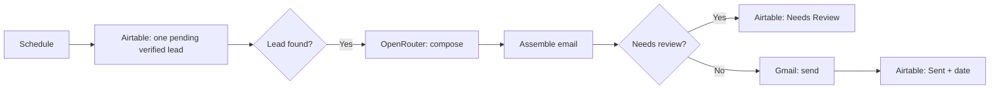

# n8n Apollo Outreach Automation

An n8n workflow for personalized B2B outreach to verified Apollo leads for **Example Brand**. This repository contains a JSON export, setup notes, and an operations checklist.

> Private project. This is a sanitized snapshot, not a live sync with n8n Cloud. Restore brand-specific copy and contact details before use.

## What it does

1. Reads one Airtable record marked `⏳ Pending` with `✅ Verified` email status, sorted by `Date Added`.
2. Uses OpenRouter to draft an email and a code node to assemble its subject and HTML body.
3. Routes drafts requiring review to `🔎 Needs Review` in Airtable.
4. Sends accepted drafts through Gmail and sets `📤 Sent` plus `Sent Date` in Airtable.

## Repository contents

- [`workflow.json`](workflow.json) - n8n export, 11 nodes.
- [`docs/setup.md`](docs/setup.md) - import, credentials, and checks before activation.
- [`docs/operations.md`](docs/operations.md) - monitoring and troubleshooting.
- [`SECURITY.md`](SECURITY.md) - credential and data-handling guidance.

## Important configuration

The schedule node is named **Every 15 Minutes**, but the supplied JSON sets `minutesInterval: 30`. Check the interval in n8n before activating. The workflow processes **one** lead per run.

Credentials are referenced by n8n but their secret values are not in this repository. Reconnect Airtable, OpenRouter, and Gmail credentials after import. Test the review route and confirm the sender account before activation.

## Related workflow

Lead collection and validation live in the separate [lead-generation repository](https://github.com/aymanjamaly/n8n-lead-generation-system).
